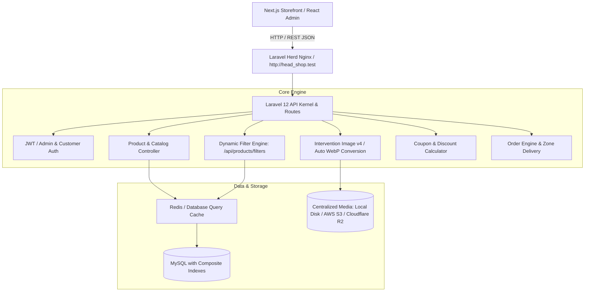

# 🧥 Herd Shop — Headless E-Commerce & Apparel REST API

> **High-Performance Headless REST API Engine** built with Laravel 12 for modern apparel e-commerce, offering centralized WebP media processing, zero-static dynamic catalog filtering, coupon engine, dynamic shipping zones, and sub-millisecond database queries.

---

## 🏗️ Architecture & Flowchart



---

## 🛠️ Technology Stack

| Layer | Technology | Details |
|---|---|---|
| **Core Framework** | Laravel 12 | Headless REST API (Zero Blade / UI rendering) |
| **PHP Runtime** | PHP 8.2 / 8.3 | Powered by Laravel Herd (`http://head_shop.test`) |
| **Database** | MySQL 8.x | Heavily indexed for sub-millisecond catalog filtering |
| **Media Processing** | Intervention Image v4.3 | Automatic WebP conversion (85% quality) + 3 responsive tiers |
| **Cloud Storage** | Flysystem AWS S3 v3 | S3, MinIO, and Cloudflare R2 ready |
| **Authentication** | Tymon JWT / Sanctum | Stateless Bearer token security + Google 2FA for Admin |
| **Caching** | Redis / Database Cache | 10-minute automated metadata caching |

---

## ⚡ Key Features & Heavy Optimizations

### 1. 100% Dynamic Catalog Filters (`GET /api/products/filters`)
- **Zero Hardcoded Data**: Frontend and Admin never store static category or filter arrays.
- Returns real-time distinct values:
  - `departments`: Men, Women, Kids, Baby, Unisex (with live product counts).
  - `categories`: Grouped with subcategory counts.
  - `fit_types`: `Regular`, `Slim Fit`, `Oversized`, `Relaxed`, etc.
  - `sizes`: In-stock sizes with active variant inventory.
  - `colors`: Hex codes and labels.
  - `price_range`: Actual dynamic `min` and `max` prices.
  - `sort_options`: Latest, Trending, Price Low-High, Price High-Low.
- **Cache Shielding**: Cached with `Cache::remember('catalog_filters_metadata', 600, ...)` to eliminate redundant SQL executions.

### 2. Centralized Media Table & Auto WebP Conversion
- Centralized `media` polymorphic table replacing fragmented image storage.
- Auto-converts uploaded JPEG, PNG, HEIC to WebP.
- Generates 3 responsive sizes:
  - `thumbnail`: 200×200 square preview
  - `medium`: 600×800 apparel ratio (3:4)
  - `large`: 1200×1600 high-res zoom
- Generates transparent blur-hash / fallback placeholders.

### 3. Apparel Domain Modeling & Complete Sizing
- Garment attributes: `fabric`, `gsm`, `fit_type`, `care_instructions`, `model_info`.
- Database-backed `size_charts` with Inch ↔ CM dimensions.
- Outfit bundle IDs for "Complete the Look" cross-selling.

### 4. Coupon & Delivery Zone Checkout Engine
- Percentage discounts, fixed amount discounts, and free shipping.
- Min purchase thresholds, max discount caps, expiry dates, and usage limits.
- Dynamic delivery calculation (`inside` city vs `outside` city).

### 5. Composite Database Indexes
- `products`: `(status, department)`, `(status, is_featured)`, `(status, fit_type)`, `price`, `ranking_score`.
- `product_variants`: `(size_id, stock)`, `(color_id, stock)`.
- `categories`: `(status, department)`.

---

## 🚀 Getting Started & Local Setup

### Prerequisites
- [Laravel Herd](https://herd.laravel.com/) (Windows or macOS)
- PHP 8.2+
- Composer 2.x
- MySQL 8.x

### Installation Steps

1. **Navigate to the Backend directory:**
   ```bash
   cd head_shop/backend
   ```

2. **Install PHP Dependencies:**
   ```bash
   composer install
   ```

3. **Configure Environment:**
   ```bash
   cp .env.example .env
   php artisan key:generate
   php artisan jwt:secret
   ```

4. **Verify Laravel Herd Domain:**
   Ensure `APP_URL` in `.env` is set to the Herd domain:
   ```env
   APP_URL=http://head_shop.test
   FRONTEND_URL=http://localhost:3000
   DB_CONNECTION=mysql
   DB_HOST=127.0.0.1
   DB_PORT=3306
   DB_DATABASE=herd_shop_db
   DB_USERNAME=root
   DB_PASSWORD=
   ```

5. **Run Migrations & Seeders:**
   ```bash
   php artisan migrate --force
   php artisan db:seed
   ```

6. **Create Storage Symlink:**
   ```bash
   php artisan storage:link
   ```

7. **Test API via Herd:**
   ```bash
   curl -i http://head_shop.test/api/products/filters
   ```

---

## 📡 Essential API Endpoints

| Method | Endpoint | Description | Access |
|---|---|---|---|
| `GET` | `/api/products` | Paginated products with multi-filter query params | Public |
| `GET` | `/api/products/filters` | Dynamic catalog filter metadata & price ranges | Public |
| `GET` | `/api/products/{slug}` | Product details with size chart, media & outfits | Public |
| `GET` | `/api/categories` | Active categories with department mapping | Public |
| `GET` | `/api/coupons/public` | Active customer promotional coupons | Public |
| `POST` | `/api/coupons/apply` | Validate & calculate coupon discount | Public |
| `POST` | `/api/orders` | Place customer order with delivery zone & coupon | Public |
| `POST` | `/api/media/upload` | Centralized image upload & WebP conversion | Admin |
| `GET` | `/api/admin/get-attributes` | Dynamic admin dropdown attributes | Admin |
| `GET` | `/api/admin/coupons` | Full CRUD management for coupons | Admin |

---

## 👨‍💻 Developer & Author Credit

Developed & Maintained by:
- **Developer:** **Sakhawat Hossain**
- **GitHub Username:** [@sajusun](https://github.com/sajusun)
- **Profile:** [https://github.com/sajusun](https://github.com/sajusun)

---
*© 2026 Herd Shop API Engine. Built with Laravel 12 & High-Performance Headless Standards.*